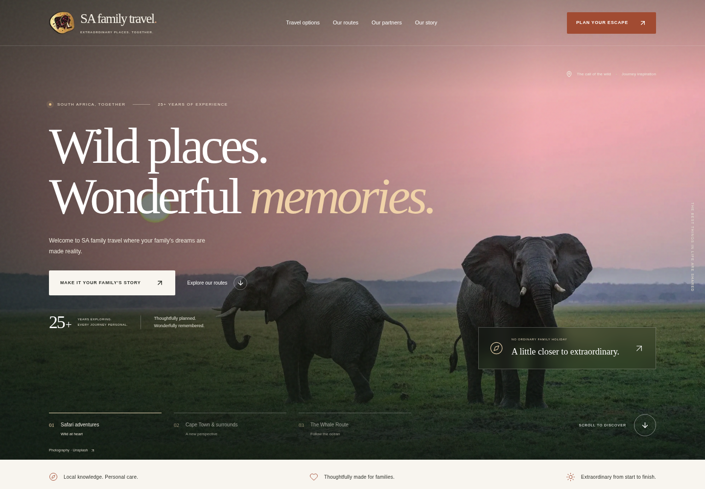
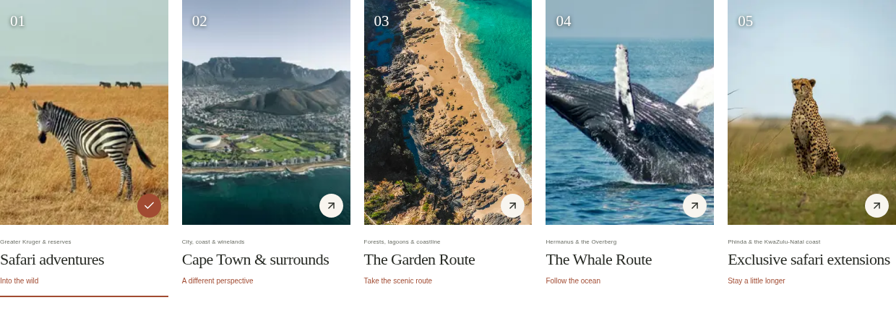

# SA Family Travel

Home Page for SA Family Travel, built with Next.js App Router, React, strict TypeScript, Tailwind CSS, Motion and Lucide. The cinematic landing section combines a transparent navigation overlay, oversized editorial typography, a slow image zoom, crossfading scenes, destination controls and a pause button. Reduced-motion users get static scenes with manual controls. Only the Home Page is implemented; subsequent pages require the owner's review and approval.

## Home Page preview



[View the mobile preview](docs/previews/mobile.png)



## Develop

Use Node.js 22 or later (validated with Node 24.19.0 and npm 11.9.0).

```sh
npm ci
npm run dev
```

In the Codex cloud machine, npm's default home cache is unavailable. Use the writable cache instead:

```sh
export npm_config_cache=/workspace/.cache/npm
export NEXT_TELEMETRY_DISABLED=1
cd /workspace/Safamilytravel
npm ci --no-audit --no-fund
npm run dev -- --port 3000
```

Use the existing isolated checkout. No additional Git worktree is needed.

## Checks

```sh
npm run typecheck
npm run lint
npm run build
```

End-to-end checks start a production server on port 3100 and stop it afterward. Build first. This cloud machine has Chromium installed:

```sh
PLAYWRIGHT_CHROMIUM_EXECUTABLE_PATH=/usr/bin/chromium npm run test:e2e
```

On another machine, install Playwright Chromium with `npx playwright install chromium`, then run `npm run test:e2e` without the executable override. The 20 browser checks exercise desktop and mobile layouts, all seven photographic placements, manual and automatic hero selection, pause/resume, reduced motion, image fallback behaviour, all five route inventories, keyboard tabs, lodge enquiry prefilling, form validation, clipboard copying, mobile navigation and 404 behaviour. Screenshots are generated under ignored `test-results/`, including `landing-desktop.png` and `landing-mobile.png`.

## Vercel deployment

`vercel.json` explicitly selects the Next.js framework, installs with `npm ci`, builds with `npm run build`, and uses `.next` as the framework output. These settings prevent a stale framework or static-output override from treating the project as a generic static site.

In the Vercel project, connect `kean346/Safamilytravel`, select production branch `main`, and keep Root Directory at the repository root where `package.json` and `vercel.json` live. Node.js 24.x matches the tested runtime. The Root Directory is a project setting and cannot be corrected by this file if the wrong folder is selected.

After pushing, check that the newest deployment uses the new commit and reaches **Ready**. Open the production domain `https://safamilytravel.vercel.app/` after it is assigned to that deployment. If Git-triggered deployment is disabled, redeploy the latest `main` commit from the Vercel dashboard. A failed build needs its build-log error resolved before the site can serve the Home Page. The repository does not need a catch-all rewrite or an `index.html` file for Next.js routing.

## Content and components

- `src/data/routes.ts`: complete inventory of 5 routes, 10 regions and 36 properties; typed image, description and family-note fields. Property age policies and amenities must be verified before adding them.
- `src/data/site.ts`: approved contacts, Instagram, brand configuration and travel options.
- `src/data/photography.ts`: local photo paths, source URLs, alt text, focal positions, fallback artwork and hero scenes.
- `src/components/`: navigation, travel tabs, route preview with native region accordions, enquiry draft form, footer and reduced-motion-aware reveal.
- `src/app/page.tsx`: Home Page composition; other marketing pages have not been created.
- `src/app/globals.css`: responsive design system, focus indicators and reduced-motion support. System serif and sans-serif stacks avoid external font requests.
- `public/images/photography/`: downloaded Unsplash JPEGs, served and optimised locally by Next.js. No external image requests are needed at runtime.
- `public/images/`: web-prepared logo, original wildlife fallback artwork and retained SVG fallback illustrations. The artwork does not depict a named lodge.

## Logo and photography

The header and footer now include `public/images/brand-icon.png`, a transparent, image-tool-prepared derivative of the attached elephant icon. This is a faithful visual preparation, not the original uploaded binary, and can differ in small details. Replace it with the owner's original PNG or SVG when available for an exact brand match; its path is configured in `src/data/site.ts`.

The user approved Unsplash imagery for the Home Page. The photos were downloaded with TLS verification and inspected visually, including the portrait crops used in the route cards. The photos are journey inspiration; none is presented as a photograph of a listed lodge. Cape Town's Table Mountain is recognisable; the general coastal and wildlife imagery does not assert a specific South African shooting location.

| Local filename | Unsplash source identifier | Content |
| --- | --- | --- |
| `elephants.jpg` | `photo-1564760055775-d63b17a55c44` | Elephants in grassland at sunset; first hero scene |
| `safari.jpg` | `photo-1516426122078-c23e76319801` | Safari vehicle and acacia trees at sunset; story section |
| `safari-zebra.jpg` | `photo-1515205244153-fce4e5d8bc49` | Zebra in golden savanna grass; safari route card |
| `cape.jpg` | `photo-1580060839134-75a5edca2e99` | Cape Town and Table Mountain |
| `garden-coast.jpg` | `photo-1547036967-23d11aacaee0` | Aerial rocky coast, beach and turquoise water; coastal inspiration |
| `whale.jpg` | `photo-1568430462989-44163eb1752f` | Breaching humpback whale |
| `safari-cheetah.jpg` | `photo-1624958319297-d1aa3a41378e` | Cheetah seated in open grassland; safari extensions card |

Full source URLs are retained in `src/data/photography.ts`. To refresh an asset, use its source URL and preserve its filename. In this cloud machine, `node --use-env-proxy` (Node 24) successfully downloads through the provided HTTP/HTTPS proxy with the existing certificate trust. Curl requests returned proxy 403, while Next.js server-side fetch without proxy activation failed DNS resolution. Do not disable TLS verification or remove proxy configuration. Unsplash destinations are saved in the environment network draft for refreshes; saving a draft alone does not apply or publish it.

`wildlife-artwork.png` is generated original elephant-and-calf artwork used only as an image-load fallback. It is distinct from the Unsplash photographs and is labelled as original artwork if displayed in the hero. Next Image serves responsive sizes and prioritises hero media. The normal browser checks assert that all photographic placements load successfully, while a separate simulated-failure test validates the fallback.

Future lodge photography can be added to `public/images/` and referenced from the typed lodge records in `src/data/routes.ts`. Never check credentials or private Drive links into source control. The user already supplied the private `SAfamilytravel` folder link in chat. Google Drive tools are still unavailable in this session, but Drive access is no longer required for the Home Page workflow. Do not request that link again.

## Enquiry delivery

The form currently validates fields, prepares a readable enquiry, pre-fills the route and property from lodge selections, and allows visitors to copy their details. **It does not send or store enquiries.** Drafts exist only in page memory and are lost on reload. The interface explicitly states that nothing has been sent.

If the owner wants a simple email-app handoff, set `NEXT_PUBLIC_ENQUIRY_EMAIL` in `.env.local` using `.env.example` as guidance, then rebuild/restart. This adds an “Open email app” action; the visitor still sends the message themselves. Public Next.js variables are embedded at build time. Do not put API keys in them.

Direct submission requires a separate server-side email integration, secure provider credentials, spam protection and appropriate privacy information. That integration is pending the owner's delivery details. Do not treat a prepared draft or a mailto handoff as successful email delivery.

## Remaining before public launch

- Review the downloaded journey imagery and the prepared logo derivative. The original logo binary can replace the derivative when available.
- Configure and verify the chosen enquiry delivery method.
- Provide street address, Facebook and TikTok links if they should appear. The footer currently uses the approved Pretoria city location and Instagram handle.
- Connect a newsletter provider before collecting subscriptions. The current footer states that the newsletter is coming soon and offers Instagram instead.
- Review the Home Page before implementing About, Contact or the full destinations explorer.
- Review metadata and switch `robots` to indexing only when the public site is approved. This development version uses `noindex, nofollow`.
- Verify the latest Vercel deployment reaches Ready and serves the production domain; the previews above show the locally tested Home Page.
